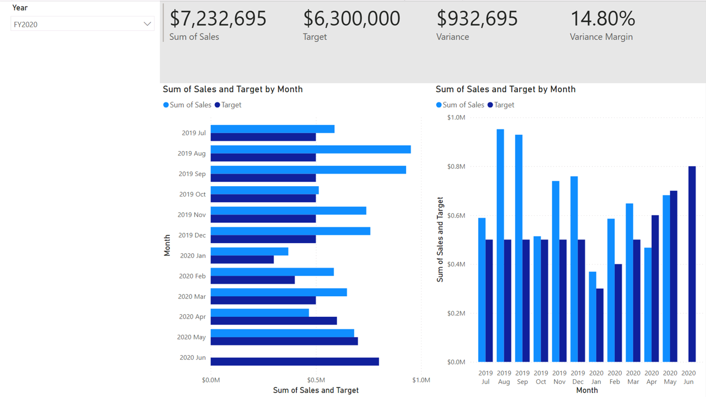
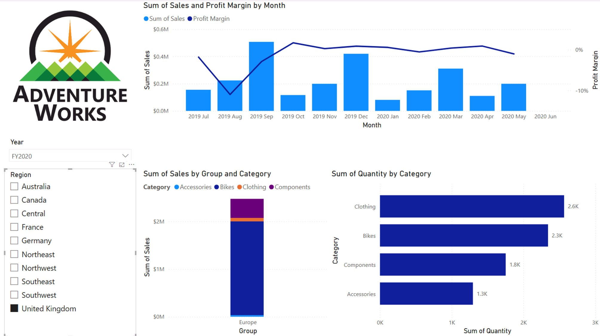
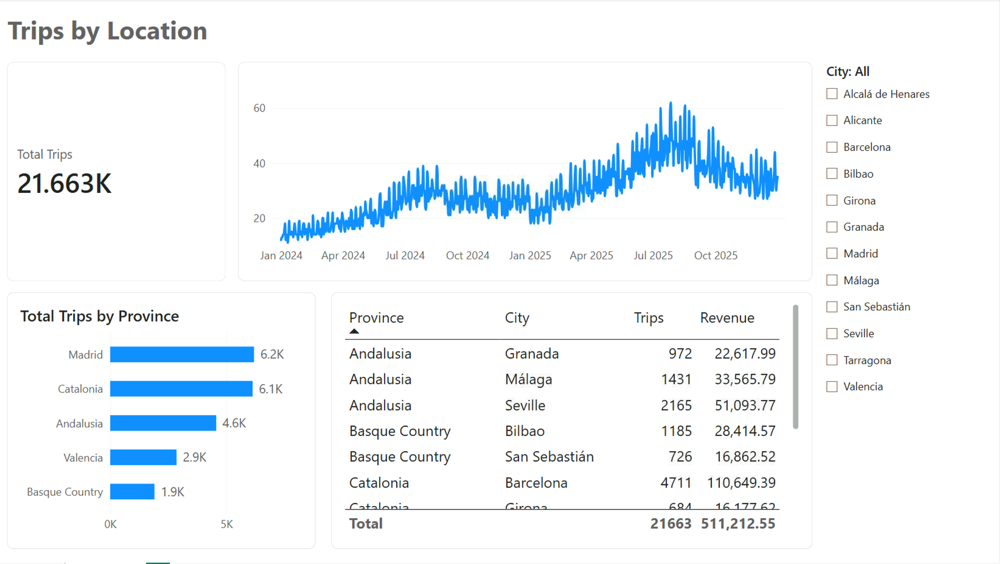
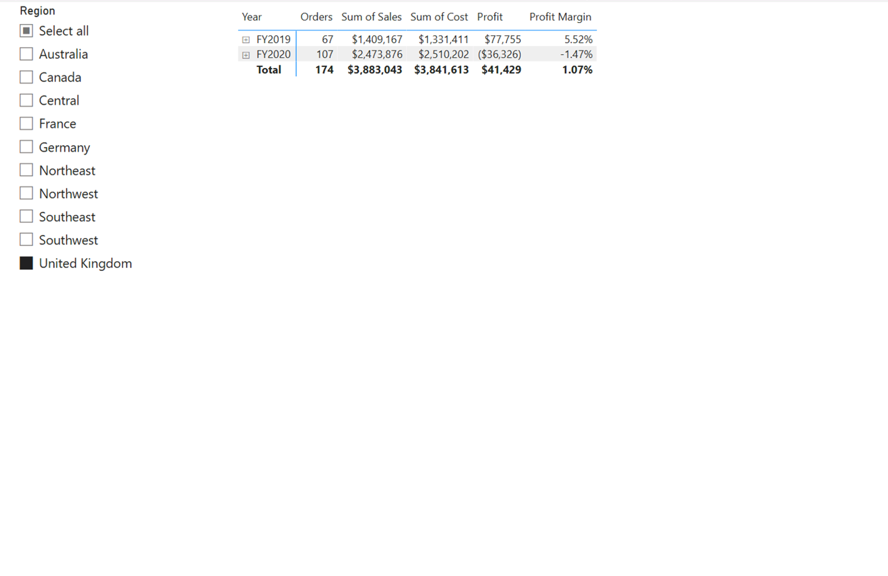

# 📊 Retail & Sales Analysis Dashboard (Power BI)

## 📌 Project Overview

This Power BI project was completed as part of a Data Technician Bootcamp. The objective was to transform raw retail and sales data into interactive business intelligence dashboards that support data-driven decision making.

The project demonstrates competencies in data cleaning, transformation, visualization, and dashboard development using Power BI.

---

## 🎯 Objectives

- 🧹 Clean and transform raw data efficiently
- 📈 Create meaningful and actionable KPIs
- 🖥️ Build fully interactive business reports
- 💡 Support strategic business decision-making
- 📊 Present clear retail and sales performance insights

---

## 🛠️ Tools & Technologies

- 📊 **Power BI** (Reporting & Dashboarding)
- 🔄 **Power Query** (Data Transformation & ETL)
- 🧮 **DAX** (Calculated Columns & Measures)
- 📗 **Excel** (Data Source & Validation)
- 🔗 **Data Modelling** (Star Schema & Relationships)

---

## 🔄 Data Preparation

The dataset was prepared using Power Query:

- 🗑️ Removed duplicate records and redundant data
- 🛠️ Handled missing values and data inconsistencies
- 🔤 Standardized data formats and naming conventions
- ➕ Created custom calculated columns for deeper analysis
- 🔗 Built robust relational data models

---

## 📈 Dashboard Features

### Sales Performance Dashboard

Key metrics tracked:

- 💰 **Total Sales** & Revenue overview
- 💵 **Total Profit** margins and profitability
- 📦 **Total Orders** volume tracking
- 🏷️ **Average Order Value (AOV)** analytics

### Interactive Filtering

Users can dynamically filter dashboards by:

- 🛍️ Product Category
- 🌍 Region & Location
- 📅 Date & Time periods
- 👥 Customer Segment

---

## 📊 Visualizations

- 📊 **Bar & Column Charts** for categorical comparisons
- 📈 **Line Charts** for temporal trends
- 🍕 **Pie & Donut Charts** for share distributions
- 📌 **KPI Cards** for high-level metrics
- 🗺️ **Maps** for geographic distribution
- 📉 **Trend Analysis** views

---

## 🧮 DAX Measures

Examples of custom DAX calculations used in the project:

- 💵 `Total Sales` = SUM(Sales[Revenue])
- 📉 `Profit Margin` = DIVIDE([Total Profit], [Total Sales])
- 📅 `YTD Sales` = TOTALYTD([Total Sales], 'Calendar'[Date])
- 🏷️ `Average Order Value` = DIVIDE([Total Sales], [Total Orders])

---

## 💡 Key Insights

- ⭐ Identified top-performing product categories driving maximum revenue
- 📈 Highlighted critical seasonal sales trends and peak periods
- 🗺️ Pinpointed high-revenue geographic regions
- ⚖️ Successfully compared sales volume against profit performance

---

## 📷 Dashboard Screenshots

### Executive Sales Performance

> *Provides a high-level overview of overall sales performance and core business KPIs.*

### Profit Margin & Category Trends

> *Shows sales growth trajectory, seasonal patterns, and product category distribution over time.*

### Geographic & Trip Distribution

> *Displays regional trip distribution, provincial insights, and localized performance metrics.*

### Financial Summary & Slicer Filter

> *Demonstrates dynamic cross-filtering using region slicers and annual financial matrix breakdowns.*
---

## 🌐 Live Report

👉 **[View Interactive Power BI Report](https://app.powerbi.com/view?r=eyJrIjoiNWVmYjU3ZGUtNTY5Yy00ZWM0LWJkMDMtNTA4M2IzYTdlZDU2IiwidCI6IjNlYTdjMTI4LWM2MDEtNDQ3OS1hMDAzLWUxNGQwMGMwYjVjYiJ9)**

---

## 🚀 Skills Demonstrated

- 🧹 Data Cleaning & Hygiene
- 🔄 Data Transformation Workflows
- ⚡ Power Query Automation
- 🧮 Advanced DAX Formulas
- 🔗 Relational Data Modeling
- 🎨 Dashboard Design & UI/UX
- 📖 Data Storytelling
- 💼 Business Intelligence (BI)
- 🖱️ Interactive Reporting Techniques
